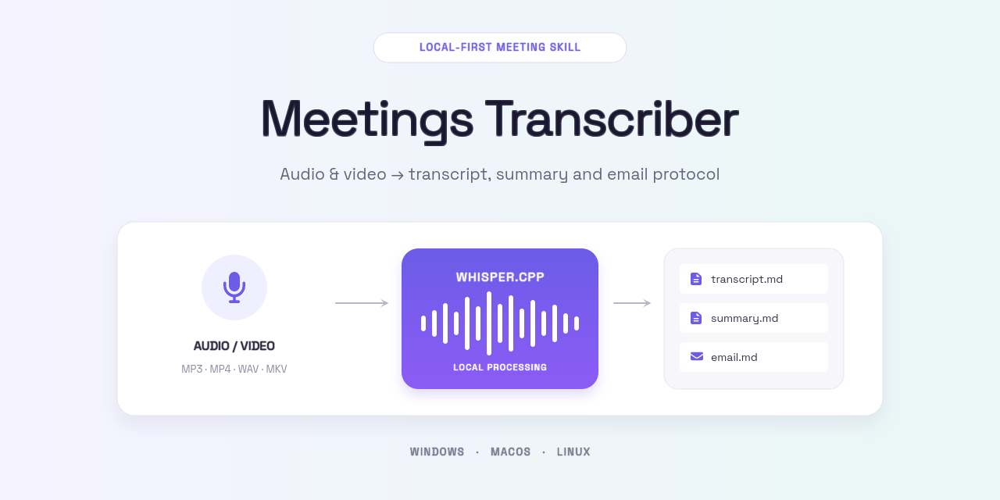
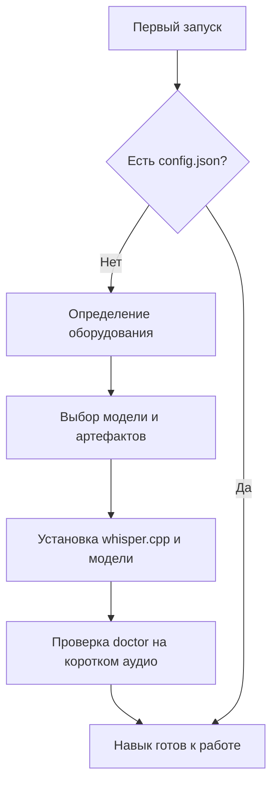
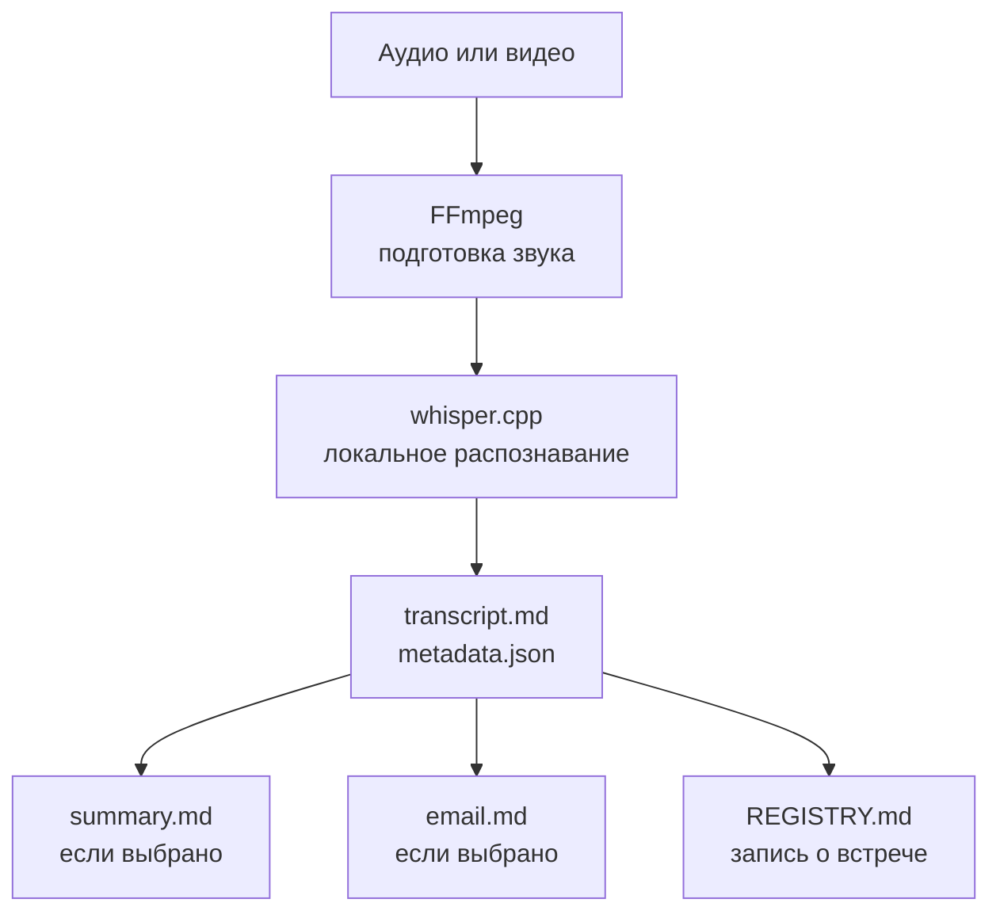
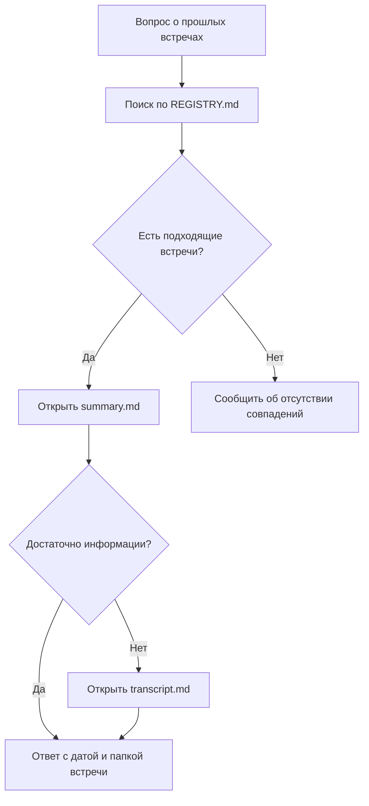

# Meetings Transcriber Skill

Навык для локальной расшифровки встреч через [whisper.cpp](https://github.com/ggml-org/whisper.cpp). Агент помогает настроить модель, запускает транскрибацию, создаёт нужные результаты и ведёт реестр встреч.

## Возможности

- Определяет ОС, процессор, память и доступный GPU.
- Помогает выбрать модель и сам устанавливает `whisper.cpp`.
- Обрабатывает аудио и видео в фоновом режиме.
- Создаёт транскрипт, саммари и короткий email-протокол.
- Сохраняет встречи в `outputs/REGISTRY.md` и ищет по архиву.

## Требования

- Windows, macOS или Linux.
- Python 3.10 или новее.
- FFmpeg и `ffprobe`.
- Интернет во время первой настройки.

Дополнительные Python-пакеты и виртуальное окружение не нужны.

## Быстрый запуск

1. Скопируйте папку `Meetings Transcriber Skill` в каталог **skills** вашей IDE или агента.
2. Убедитесь, что среда автоматически обнаруживает `SKILL.md`. Если автоматического обнаружения нет, добавьте в общие правила или правило-маршрутизатор вышестоящего агента:

   > Для запросов о настройке, транскрибации, статусе и поиске встреч загрузи `Meetings Transcriber Skill/SKILL.md` и следуй его инструкциям.

3. Отправьте одну из команд:

   ```text
   Start
   Transcribation Start
   Transcription Start
   ```

4. Выберите модель и нужные артефакты.
5. Дождитесь установки и проверки `doctor`.
6. Положите запись в `recordings/` и напишите: **«Транскрибируй последнюю встречу»**.

Если IDE поддерживает интерактивные вопросы, выбор появится в её интерфейсе. Иначе агент покажет нумерованные варианты в чате.

## Как работает настройка



## Как работает транскрибация



## Как работает поиск



Агент не читает весь архив: сначала использует реестр, затем открывает только подходящие саммари. Полный транскрипт открывается при отсутствии или недостатке саммари, а также для проверки точной формулировки.

## Артефакты

| Файл | Содержимое | По умолчанию |
|------|------------|--------------|
| `transcript.md` | Полная расшифровка с временными метками | Всегда |
| `summary.md` | Темы, решения, договорённости и следующие шаги | Включён |
| `email.md` | Короткий текст протокола для письма | Выключен |
| `metadata.json` | Модель, язык, длительность и сведения об источнике | Всегда |

Выбор сохраняется в `config.json`:

```json
"artifacts": {
  "transcript": true,
  "summary": true,
  "email": false
}
```

## Структура папки

```text
Meetings Transcriber Skill/
├── SKILL.md                  # Правила работы агента и все сценарии навыка
├── README.md                 # Руководство пользователя
├── .gitignore                # Исключение локальных файлов и результатов из Git
├── config.example.json       # Пример всех настроек навыка
├── config.json               # Локальная конфигурация; создаётся при первом Start
├── assets/                   # Баннер и другие изображения документации
├── scripts/                  # Исполняемая логика навыка
├── templates/                # Шаблоны результатов, создаваемых агентом
│   ├── summary.md            # Структура саммари встречи
│   └── email.md              # Структура короткого email-протокола
├── recordings/               # Исходные аудио- и видеозаписи
├── outputs/                  # Результаты обработки встреч
│   ├── REGISTRY.md           # Реестр встреч и точка входа для поиска
│   └── YYYY-MM-DD_meeting/   # Результаты одной встречи
│       ├── transcript.md     # Полная расшифровка с временными метками
│       ├── summary.md        # Саммари; создаётся, если выбрано
│       ├── email.md          # Email-протокол; создаётся, если выбран
│       └── metadata.json     # Модель, язык, длительность и данные источника
├── models/                   # Скачанные модели Whisper и VAD
├── runtime/                  # Движок whisper.cpp и временные рабочие файлы
├── logs/                     # Логи установки, заданий и движка
└── state/                    # Состояние текущего фонового задания
```

## Модели

Используются мультиязычные модели Whisper, подходящие в том числе для русской речи.

| Модель | Размер | Когда выбрать |
|--------|-------:|---------------|
| `tiny` | 75 MiB | Самый быстрый тест |
| `base` | 142 MiB | Лёгкие записи и простая проверка |
| `small` | 466 MiB | Черновая расшифровка |
| `medium` | 1,5 GiB | Более высокое качество на CPU |
| `large-v3-turbo-q5_0` | 547 MiB | Компактный large-вариант |
| `large-v3-turbo` | 1,5 GiB | Баланс качества и скорости |
| `large-v3` | 2,9 GiB | Максимальное качество |

Для `tiny`, `base` и `small` в Windows/Linux автоматически используется компактный CPU-движок — большой CUDA-пакет не скачивается. Для тяжёлых моделей агент учитывает доступное GPU-ускорение.

## Поддерживаемые форматы

- **Аудио:** `.mp3`, `.wav`, `.m4a`, `.ogg`, `.flac`, `.webm`, `.aac`.
- **Видео:** `.mp4`, `.mkv`, `.avi`, `.mov`, `.wmv`, `.webm`.
